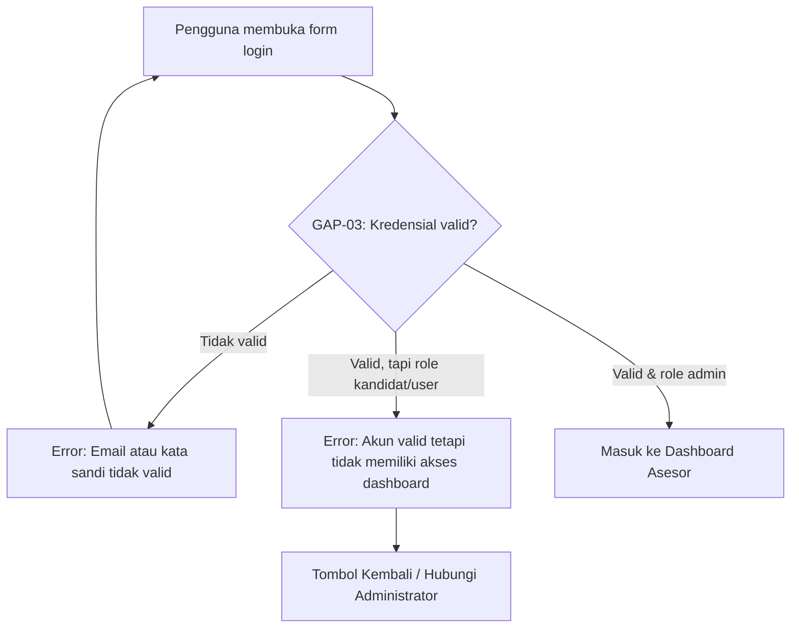
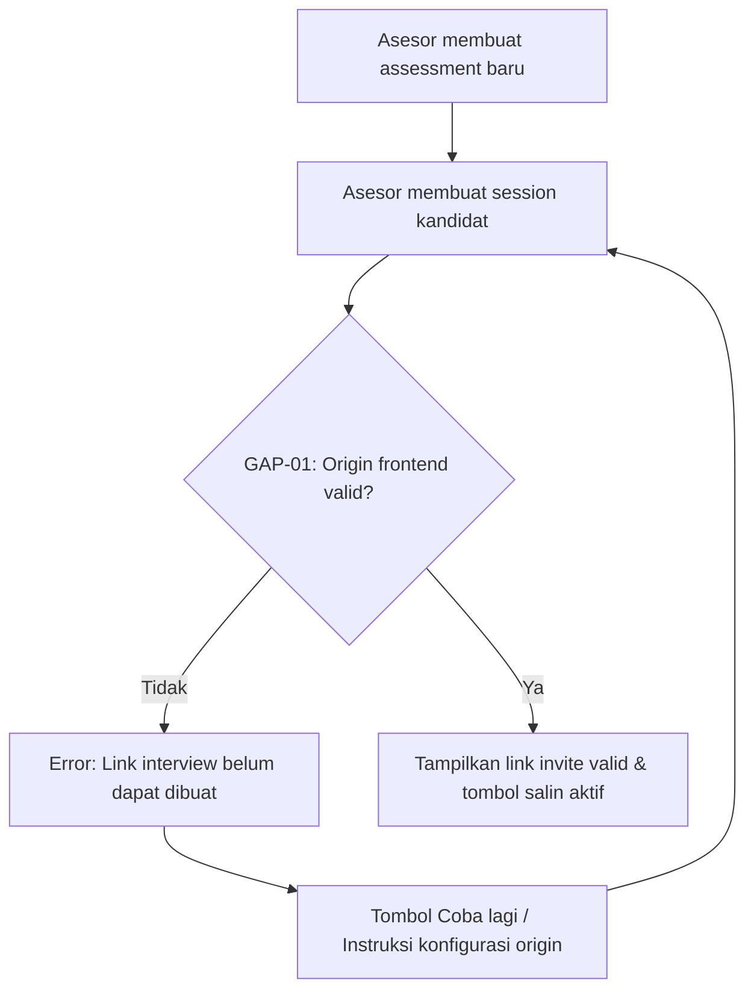
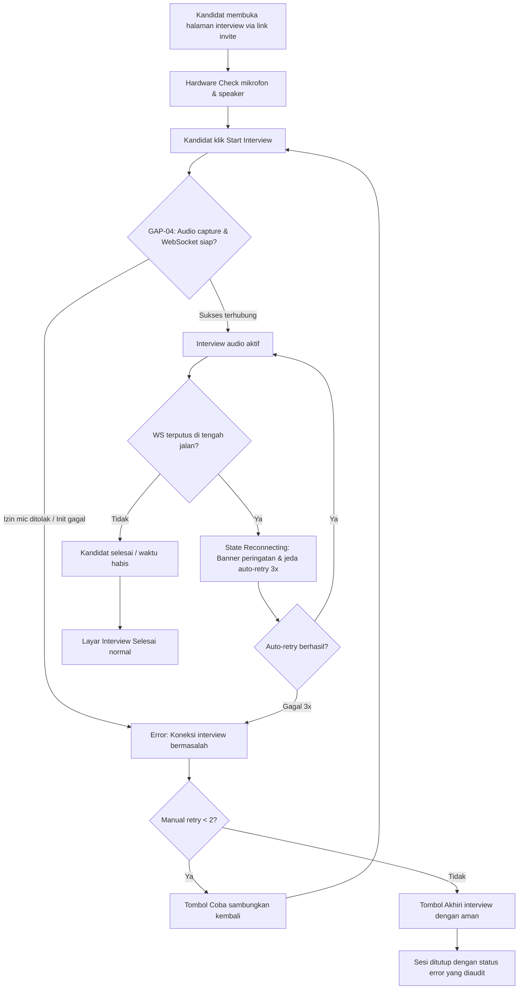
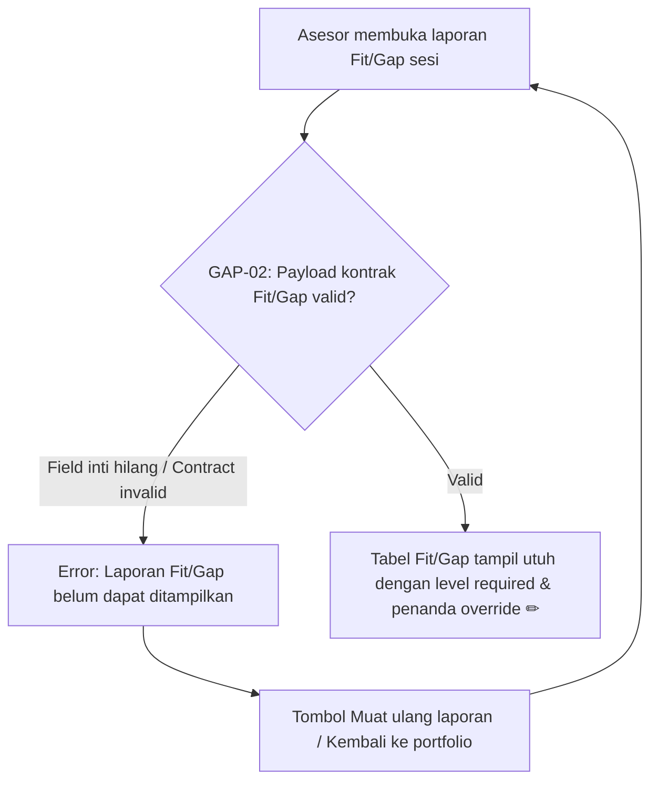
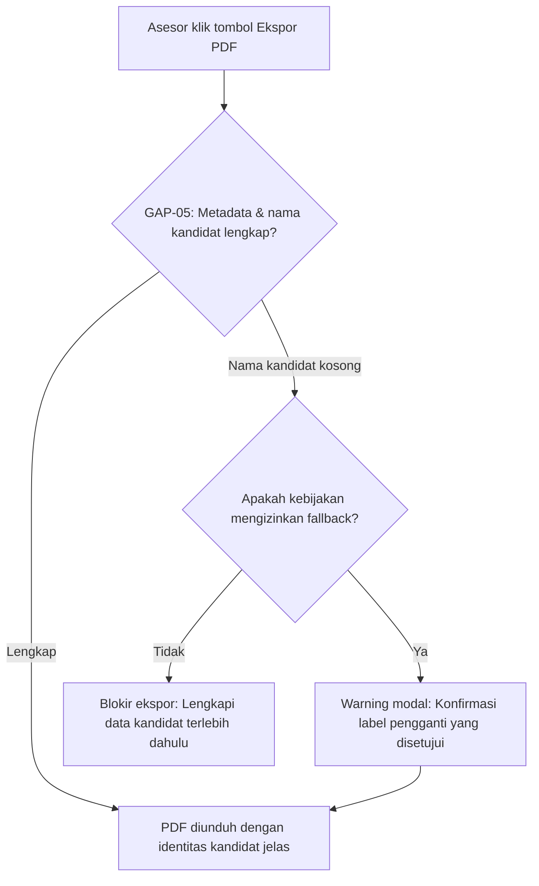

# Step 4: Strategi Revamp, Acceptance Criteria & Trade-offs

Dokumen ini menyelaraskan rencana perbaikan untuk lima temuan aktif pada [ANALISIS_MASALAH_DAN_CELAH_LANGKAH_3.md](file:///F:/Project/rakamin/ai-interview-platform/ANALISIS_MASALAH_DAN_CELAH_LANGKAH_3.md): **GAP-01** sampai **GAP-05**. Dokumen berfokus pada perilaku produk yang dituju, acceptance criteria, pilihan solusi, serta trade-off—tanpa cuplikan source code.

---

## Matriks Prioritas Revamp

| ID         | Prioritas | Kondisi produk ideal                                                              | Keputusan revamp                                                                                            |
| :--------- | :-------: | :-------------------------------------------------------------------------------- | :---------------------------------------------------------------------------------------------------------- |
| **GAP-01** |  **P0**   | Invite selalu membuka halaman kandidat pada environment yang benar.               | Perbaiki satu konfigurasi origin frontend dan fallback URL backend; tanpa rekonstruksi URL di frontend.     |
| **GAP-02** |  **P0**   | Data Fit/Gap konsisten dari backend sampai tabel frontend.                        | Selaraskan satu nama field pada type dan tabel frontend; tambahkan status override pada respons yang ada.   |
| **GAP-03** |  **P1**   | Pengguna menerima alasan penolakan login yang tepat.                              | Bedakan respons role ditolak dari kredensial salah dalam endpoint login yang ada.                           |
| **GAP-04** |  **P0**   | Start interview tidak menjatuhkan backend; gangguan dapat diamati dan dipulihkan. | Tambahkan observabilitas dan penanganan gagal/retry pada arsitektur socket saat ini; tunda migrasi runtime. |
| **GAP-05** |  **P2**   | PDF mudah diidentifikasi secara aman saat dibagikan internal.                     | Setujui field minimum lalu tambahkan nama kandidat pada header PDF; tunda redesign cover/nama file.         |

---

## GAP-01 — URL Invite Mengarah ke Origin yang Salah

### Acceptance criteria

- Setiap sesi baru menghasilkan URL dengan origin frontend yang valid dan rute interview kandidat.
- URL invite mengikuti environment aktif: lokal, staging, dan production.
- URL dapat dibuka di browser incognito tanpa login asesor dan tanpa menerima respons halaman API.
- URL yang ditampilkan dan disalin asesor sama dengan URL yang dihasilkan backend.
- Jika origin frontend kosong atau tidak valid, sistem tidak menerbitkan invite yang tidak dapat digunakan dan menghasilkan error konfigurasi yang dapat ditindaklanjuti.

### Opsi solusi & trade-off

| Opsi                                               | Dampak produk vs biaya                                               | Maintainability                   | Risiko kegagalan                                             |
| :------------------------------------------------- | :------------------------------------------------------------------- | :-------------------------------- | :----------------------------------------------------------- |
| **A. Konfigurasi origin frontend per environment** | Dampak tinggi, biaya rendah; memperbaiki sumber seluruh invite baru. | Tinggi; dikelola saat deployment. | Salah konfigurasi deployment masih dapat membuat link salah. |
| **B. Frontend membentuk ulang URL ketika copy**    | Perbaikan UX cepat.                                                  | Sedang; terdapat dua sumber URL.  | Integrasi lain masih bisa memakai URL backend yang salah.    |
| **C. Satu domain publik dengan reverse proxy**     | Pengalaman paling rapi, biaya infrastruktur lebih tinggi.            | Tinggi setelah stabil.            | Membutuhkan perubahan routing dan SSL.                       |

### Keputusan revamp

Pilih **Opsi A** saja untuk implementasi pertama: perbaiki konfigurasi origin dan fallback backend. Jangan membentuk ulang URL di frontend karena membuat dua sumber kebenaran. Opsi C ditunda hingga ada kebutuhan deployment yang nyata.

### Verifikasi

- Buat invite di setiap environment lalu buka pada browser incognito.
- Pastikan halaman kandidat tampil tanpa respons halaman API.
- Uji origin kosong dan invalid; pastikan invite tidak diterbitkan sebagai link yang rusak.

---

## GAP-02 — Kontrak Data Fit/Gap Tidak Konsisten

### Acceptance criteria

- Respons Fit/Gap menggunakan satu nama field kanonis untuk level kebutuhan skill.
- Frontend membaca nama field yang sama dengan respons backend.
- Setiap perbandingan valid menampilkan level kebutuhan dan level kandidat tanpa nilai `undefined`.
- Status override dikirim backend dan tampil di frontend hanya ketika override benar-benar ada.
- Kondisi `match`, `gap`, `exceed`, dan override menampilkan label serta level yang sesuai kontrak.

### Opsi solusi & trade-off

| Opsi                                                    | Dampak produk vs biaya                       | Maintainability                              | Risiko kegagalan                                            |
| :------------------------------------------------------ | :------------------------------------------- | :------------------------------------------- | :---------------------------------------------------------- |
| **A. Menyamakan frontend dengan field backend kanonis** | Biaya rendah dan perbaikan cepat.            | Tinggi bila istilah domain telah disepakati. | Consumer lama dapat memakai nama field berbeda.             |
| **B. Backend mengirim alias sementara**                 | Mengurangi risiko rollout bertahap.          | Sedang; alias harus dihapus sesuai tenggat.  | Kontrak menjadi ambigu bila alias dibiarkan permanen.       |
| **C. Versioning API penuh**                             | Paling aman untuk banyak consumer eksternal. | Lebih kompleks.                              | Overhead tidak sebanding untuk kebutuhan internal saat ini. |

### Keputusan revamp

Pilih **Opsi A** sebagai implementasi pertama: samakan type dan consumer frontend dengan field kanonis yang telah dikirim backend, lalu tambahkan indikator override pada respons yang sama. Opsi B hanya dipakai bila ada consumer lama yang terbukti membutuhkan kompatibilitas.

### Verifikasi

- Uji kondisi match, gap, exceed, dan override.
- Pastikan semua level dan label tampil benar di tabel tanpa `undefined`.
- Validasi respons API terhadap skema yang disepakati.
- Lakukan regresi pada halaman/ekspor yang memakai data Fit/Gap.

---

## GAP-03 — Pesan Penolakan Login Tidak Sesuai Penyebab

### Acceptance criteria

- Kredensial salah menghasilkan kegagalan autentikasi yang konsisten.
- Password benar tetapi role tidak diizinkan menghasilkan penolakan otorisasi yang berbeda dan dapat ditindaklanjuti.
- Role non-admin yang ditolak tidak menerima token sesi dashboard dan tidak dapat mengakses endpoint asesor/admin.
- Kandidat tetap memakai alur invite; perubahan tidak membuka dashboard untuk kandidat.
- Frontend menampilkan pesan jelas tanpa membocorkan informasi sensitif tentang akun.
- Audit log membedakan password salah dan role ditolak.

### Opsi solusi & trade-off

| Opsi                                            | Dampak produk vs biaya                     | Maintainability                 | Risiko kegagalan                                                |
| :---------------------------------------------- | :----------------------------------------- | :------------------------------ | :-------------------------------------------------------------- |
| **A. Bedakan autentikasi dan otorisasi**        | Dampak UX tinggi, biaya rendah.            | Tinggi dan sesuai standar HTTP. | Pesan yang terlalu rinci dapat mengungkap informasi role.       |
| **B. Satu pesan generik untuk semua kegagalan** | Biaya nol, informasi lebih minim.          | Tinggi secara teknis.           | Support meningkat karena pengguna valid tidak tahu penyebabnya. |
| **C. Portal terpisah per role**                 | UX paling jelas bila kandidat butuh login. | Sedang; scope produk meningkat. | Menambah rute dan aturan tanpa kebutuhan yang disetujui.        |

### Keputusan revamp

Pilih **Opsi A**. Perubahannya terbatas pada endpoint login dan cara frontend menampilkan pesan respons; tidak membuat portal baru, tidak menambah role baru, dan tidak mengubah hak akses kandidat.

### Verifikasi

- Uji email/password salah.
- Uji password valid dengan role tidak berhak dan pastikan token tidak diterbitkan.
- Uji login admin valid.
- Pastikan UI tidak menyamakan penolakan role dengan password salah.

---

## GAP-04 — Stabilitas Runtime Audio WebSocket di Windows

### Acceptance criteria

- Skenario start interview pada Windows target dapat direproduksi atau dinyatakan tidak dapat direproduksi dengan bukti environment, versi dependency, log, dan langkah uji.
- Log proses tersedia sebelum, saat, dan setelah koneksi audio dibuat.
- Exit process, restart, crash dump, dan error koneksi dapat dibedakan secara jelas.
- Skenario pemicu yang sebelumnya menjatuhkan proses dapat dijalankan berulang sesuai jumlah iterasi yang disepakati tanpa proses berhenti.
- Jika koneksi audio gagal, kandidat menerima status kegagalan yang jelas dan backend tetap hidup.
- Audio dua arah, transkrip, reconnect, dan end session berhasil diuji pada platform deployment target.
- Kapasitas koneksi simultan dan batas operasional terdokumentasi.
- Perubahan tidak melemahkan keamanan invite token dan isolasi sesi kandidat.

### Opsi solusi & trade-off

| Opsi                                                | Dampak produk vs biaya                           | Maintainability                                     | Risiko kegagalan                                              |
| :-------------------------------------------------- | :----------------------------------------------- | :-------------------------------------------------- | :------------------------------------------------------------ |
| **A. Menata operasi socket pada reactor yang sama** | Biaya sedang; stabilisasi implementasi saat ini. | Sedang; masih bergantung pada library dan platform. | Crash native atau ketidakcocokan Windows dapat tetap terjadi. |
| **B. Audio runtime pada Linux/container terpisah**  | Stabilitas tinggi; biaya DevOps sedang.          | Tinggi; runtime seragam dan mudah dipantau.         | Menambah komunikasi antar layanan.                            |
| **C. Gateway audio real-time khusus**               | Skalabilitas terbaik, biaya awal tertinggi.      | Tinggi jika ownership jelas.                        | Menambah kompleksitas distributed system.                     |

### Keputusan revamp

Mulai dari **Opsi A** dan observabilitas minimum pada proses yang ada: reproduksi masalah, catat lifecycle koneksi, dan pastikan kegagalan koneksi tidak menghentikan proses serta mengaktifkan error state/retry terbatas di UI. Opsi B dan C ditunda karena membutuhkan perubahan infrastruktur/layanan baru; hanya dipertimbangkan jika mitigasi ini tidak menutup kegagalan yang dapat direproduksi.

### Verifikasi

- Jalankan start, reconnect, refresh halaman, dan end session berulang.
- Bandingkan Windows target dan Linux/container.
- Pantau uptime proses, log koneksi, dan error native.
- Uji koneksi simultan sesuai batas kapasitas yang disetujui.

---

## GAP-05 — Spesifikasi Identitas Dokumen PDF Belum Ditetapkan

### Acceptance criteria _(provisional sampai disetujui Product/Recruiting)_

- Product/Recruiting menyetujui field identitas minimum yang wajib ada dalam PDF.
- PDF menampilkan identitas kandidat dan konteks laporan pada lokasi yang telah disetujui serta sesuai aturan privasi.
- Untuk nama kandidat yang kosong, PDF memakai fallback yang telah disetujui.
- Dokumen tetap dapat dibedakan ketika beberapa PDF diunduh bersamaan.
- Tidak ada data personal tambahan yang ditampilkan tanpa kebutuhan bisnis yang disetujui.

### Opsi solusi & trade-off

| Opsi                                       | Dampak produk vs biaya             | Maintainability                                    | Risiko kegagalan                                        |
| :----------------------------------------- | :--------------------------------- | :------------------------------------------------- | :------------------------------------------------------ |
| **A. Nama kandidat pada header/cover**     | Identifikasi tinggi, biaya rendah. | Tinggi; perubahan lokal pada format dokumen.       | Nama kosong dan privasi membutuhkan fallback/aturan.    |
| **B. Hanya memperbaiki nama file unduhan** | Cepat membantu pengelolaan file.   | Tinggi.                                            | Tidak membantu saat PDF dicetak atau dipisah dari file. |
| **C. Cover lengkap dengan metadata**       | Laporan paling profesional.        | Sedang; butuh desain dan persetujuan lebih banyak. | Risiko metadata berlebihan.                             |

### Keputusan revamp

Setujui field identitas minimum bersama Product/Recruiting, lalu pilih **Opsi A** sebagai implementasi pertama: tampilkan nama kandidat atau fallback yang disetujui pada header PDF yang sudah ada. Tunda perubahan nama file dan cover lengkap agar scope perbaikan tetap kecil.

### Verifikasi

- Review dan setujui field identitas bersama Product/Recruiting.
- Uji nama kandidat normal, kosong, panjang, dan karakter khusus.
- Pastikan PDF dan nama file mengikuti spesifikasi serta aturan privasi.
- Review hasil pada layar dan hasil cetak.

---

## Definition of Done

Sebuah GAP boleh berstatus **Resolved** hanya jika:

1. Seluruh acceptance criteria lulus.
2. Opsi solusi dipilih dan disetujui pemilik teknis/produk.
3. Uji regresi selesai dan buktinya tersimpan.
4. Failure mode yang tersisa memiliki pemilik serta mitigasi.
5. Dokumen audit dan tracker remediasi diperbarui konsisten.

---

## Rancangan Error State untuk GAP-01 sampai GAP-05

Bagian ini menetapkan perilaku ketika kondisi gagal terjadi. Tujuannya bukan hanya menampilkan pesan error, tetapi juga mencegah pengguna melanjutkan dengan data/sesi yang tidak valid, menyediakan tindakan pemulihan, dan menghasilkan bukti operasional bagi tim teknis.

### Prinsip umum

- **Jelas dan dapat ditindaklanjuti:** pesan menyebutkan apa yang gagal serta langkah pengguna berikutnya.
- **Tidak menyalahkan pengguna:** hindari pesan teknis seperti nama exception, port, stack trace, atau detail internal.
- **Aman:** jangan menampilkan token invite, data tenant lain, atau detail autentikasi dalam UI dan log client.
- **Mencegah state palsu:** UI tidak boleh menunjukkan “sukses”, “aktif”, atau “selesai” bila operasi inti sebenarnya gagal.
- **Teramati:** setiap error memiliki kode stabil untuk log, metrik, dan triase support.

### Matriks Error State

| GAP        | Pemicu                                                                                                            | Error state di UI                                                                                                                                                                          | Aksi pemulihan pengguna                                                                                                                                       | Respons/observabilitas sistem                                                                                                                                                                      |
| :--------- | :---------------------------------------------------------------------------------------------------------------- | :----------------------------------------------------------------------------------------------------------------------------------------------------------------------------------------- | :------------------------------------------------------------------------------------------------------------------------------------------------------------ | :------------------------------------------------------------------------------------------------------------------------------------------------------------------------------------------------- |
| **GAP-01** | Origin frontend tidak tersedia, tidak valid, atau invite yang dihasilkan tidak mengarah ke halaman kandidat.      | Di halaman asesmen, tampilkan status **“Link interview belum dapat dibuat”**; jangan tampilkan tombol copy sebagai sukses.                                                                 | Tombol **Coba lagi** setelah konfigurasi diperbaiki; tombol **Hubungi administrator**/instruksi singkat untuk lingkungan lokal.                               | Backend menolak menerbitkan invite yang tidak valid; catat `INVITE_ORIGIN_INVALID` beserta environment dan correlation ID, tanpa token penuh.                                                      |
| **GAP-02** | Payload Fit/Gap tidak memenuhi kontrak, field level wajib hilang, atau status override tidak dapat dipetakan.     | Ganti tabel dengan panel **“Laporan Fit/Gap belum dapat ditampilkan dengan benar”**; jangan render nilai kosong atau `undefined`.                                                          | Tombol **Muat ulang laporan**; bila tetap gagal, opsi kembali ke portfolio.                                                                                   | Catat `FITGAP_CONTRACT_INVALID` dengan versi kontrak, field yang hilang, report ID, dan correlation ID; kirim alert bila berulang.                                                                 |
| **GAP-03** | Password valid tetapi role tidak berhak memakai dashboard; atau kredensial salah.                                 | Untuk role ditolak: **“Akun Anda valid, tetapi tidak memiliki akses ke dashboard ini.”** Untuk kredensial salah: pesan generik **“Email atau kata sandi tidak valid.”**                    | Role ditolak: tombol **Kembali** dan instruksi menghubungi administrator. Kredensial salah: tetap di form untuk mencoba lagi/reset password sesuai kebijakan. | Gunakan status/jenis error yang berbeda untuk autentikasi vs otorisasi; catat `AUTH_INVALID_CREDENTIALS` atau `AUTH_ROLE_FORBIDDEN`. Jangan menerbitkan token pada role ditolak.                   |
| **GAP-04** | Koneksi audio/Gemini gagal, proses audio tidak siap, WebSocket terputus permanen, atau health check proses gagal. | Tampilan interview berubah ke state **“Koneksi interview bermasalah”**; hentikan timer ketika sesi tidak bisa dilanjutkan dan jangan menampilkan status connected palsu.                   | Tombol **Coba sambungkan kembali** dengan batas retry; setelah batas tercapai, tampilkan **Akhiri interview dengan aman** dan instruksi menghubungi asesor.   | Backend mempertahankan proses hidup, mencatat `AUDIO_CONNECTION_FAILED`, `AUDIO_RUNTIME_UNHEALTHY`, atau `AUDIO_RETRY_EXHAUSTED`; publikasikan status sesi yang konsisten dan pantau uptime/crash. |
| **GAP-05** | Nama kandidat kosong atau metadata PDF tidak memenuhi spesifikasi yang disetujui.                                 | Sebelum unduh, tampilkan peringatan nonblokir: **“Nama kandidat tidak tersedia; PDF akan memakai label pengganti.”** Jika metadata wajib tidak tersedia, blokir ekspor dengan pesan jelas. | Pengguna dapat kembali ke data sesi untuk melengkapi nama kandidat atau meneruskan dengan fallback jika kebijakan mengizinkan.                                | Catat `PDF_CANDIDATE_NAME_MISSING` atau `PDF_METADATA_INVALID`; gunakan fallback yang disetujui dan jangan memasukkan data personal lain secara otomatis.                                          |

### Detail Perilaku per GAP

#### GAP-01 — Error State Invite Tidak Valid

- **Kondisi blokir:** tidak ada link yang dapat disalin/dikirim bila tujuan bukan origin frontend yang diizinkan.
- **Pesan asesor:** “Link interview belum dapat dibuat karena konfigurasi aplikasi belum lengkap. Coba lagi setelah administrator memperbaiki konfigurasi.”
- **Pemulihan:** setelah konfigurasi diperbaiki, asesor membuat atau me-refresh sesi untuk memperoleh link baru; link rusak lama tidak dipakai ulang.
- **Batasan:** jangan mencoba menebak domain production dari browser bila backend sedang mengembalikan origin yang invalid.

#### GAP-02 — Error State Kontrak Fit/Gap Tidak Valid

- **Kondisi blokir:** tabel tidak dirender parsial bila field inti perbandingan tidak lengkap.
- **Pesan asesor:** “Data laporan Fit/Gap sedang tidak lengkap. Muat ulang laporan atau kembali beberapa saat lagi.”
- **Pemulihan:** lakukan satu refresh manual; jika kegagalan sama terulang, tampilkan report reference untuk support tanpa mengekspos data kandidat.
- **Batasan:** jangan mengganti level kosong menjadi level default karena dapat mengubah interpretasi keputusan hiring.

#### GAP-03 — Error State Login dan Akses Role

- **Kondisi blokir:** role yang tidak berhak tidak memperoleh token, redirect dashboard, atau akses endpoint terlindungi.
- **Pesan pengguna:** pisahkan pesan untuk kredensial invalid dan akun valid tetapi portal tidak sesuai.
- **Pemulihan:** role ditolak diarahkan untuk memakai alur yang sesuai (misalnya invite kandidat) atau menghubungi administrator; bukan mencoba password berulang.
- **Batasan:** pesan tidak menyebut daftar role, tenant, atau keberadaan akun selain yang diperlukan untuk membantu pengguna sah.

#### GAP-04 — Error State Koneksi Audio Real-time

- **Kondisi blokir:**
    - _Fase Pre-start:_ Bila izin mikrofon ditolak, hardware audio tidak siap, atau inisialisasi backend/upstream gagal, cegah kandidat masuk ke state "interview aktif".
    - _Fase Mid-interview:_ Bila WebSocket terputus di tengah sesi, hentikan timer percakapan dan mute mikrofon sementara; jangan menampilkan status audio connected palsu.
- **Pesan kandidat:**
    - _Saat reconnecting:_ “Koneksi interview terputus. Kami sedang mencoba menyambungkan kembali. Jangan tutup halaman.”
    - _Saat gagal permanen / setup error:_ “Koneksi interview bermasalah. Kami tidak dapat menyambungkan koneksi audio interview Anda” (disertai petunjuk kontekstual izin mikrofon/perangkat jika relevan).
- **Pemulihan bertingkat:**
    - Auto-retry WebSocket otomatis (maksimum 3 kali dengan backoff bertahap).
    - Jika auto-retry habis, tampilkan panel kendala koneksi dengan tombol **Coba sambungkan kembali** (manual retry terbatas, maks 2 kali).
    - Opsi jalan keluar aman: tombol **Akhiri interview dengan aman** yang menutup sesi dengan audit reason `error` tanpa looping tak berujung.
- **Konsistensi sesi & anti-state palsu:**
    - Backend tidak boleh mengirim event `session_ended` untuk kegagalan koneksi (wajib menggunakan event `retry_exhausted` atau `error`), agar frontend tidak salah merender layar sukses "Interview Complete (✅)".
    - Backend menangani kegagalan upstream secara anggun di level aplikasi tanpa membiarkan native runtime/process crash.
- **Batasan:** jangan otomatis menandai interview selesai, jangan memicu kalkulasi skor/penilaian jika sesi gagal sebelum durasi/transkrip minimum terpenuhi.

#### GAP-05 — Error State Metadata PDF

- **Kondisi blokir:** bila nama kandidat adalah field wajib menurut spesifikasi yang disetujui, ekspor ditolak sampai data dilengkapi.
- **Pesan pengguna:** “Nama kandidat belum tersedia. Lengkapi data kandidat sebelum mengunduh laporan.”
- **Pemulihan alternatif:** bila fallback diperbolehkan, tampilkan pilihan eksplisit untuk melanjutkan dengan label pengganti yang disetujui.
- **Batasan:** fallback tidak boleh berasal dari ID internal, email, atau data personal lain tanpa persetujuan kebijakan privasi.

### Flow Diagram UI Setelah Revamp

Berikut adalah alur normal dan penanganan error state yang **dipisahkan per modul/fitur** agar jelas batasan tanggung jawabnya pada implementasi frontend dan backend:

#### 1. Alur Autentikasi & Kontrol Akses (GAP-03)

#### 2. Alur Pembuatan Assessment & Link Invite (GAP-01)

#### 3. Alur Sesi Interview Kandidat & Koneksi Audio (GAP-04)

#### 4. Alur Review Hasil & Laporan Fit/Gap (GAP-02)

#### 5. Alur Ekspor Laporan PDF (GAP-05)

**Interpretasi alur:**

- Masing-masing diagram mengisolasi interaksi pengguna dan state mesin pada halamannya sendiri.
- Tidak ada percabangan silang yang membingungkan implementasi antar halaman.

#### Batas perubahan UX

- **Tidak ada perubahan route utama** atau urutan bisnis normal.
- **Tidak ada akses baru untuk kandidat** ke dashboard asesor/admin.
- **Tidak ada keputusan otomatis** pada data Fit/Gap yang tidak lengkap.
- **Tidak ada loop retry tanpa akhir** pada interview audio.
- **Tidak ada fallback identitas PDF** yang mengambil data personal lain tanpa persetujuan.

### Acceptance Criteria Error State

Rancangan error state dianggap selesai bila:

1. Setiap pemicu pada matriks dapat diuji dan menghasilkan state UI yang tidak ambigu.
2. UI tidak menampilkan keberhasilan palsu untuk invite, laporan, login, koneksi audio, atau ekspor PDF yang gagal.
3. Aksi pemulihan dapat dijalankan pengguna tanpa perlu memahami detail teknis sistem.
4. Setiap kondisi memiliki kode error stabil, correlation ID, dan log server yang cukup untuk investigasi.
5. Pesan serta fallback telah ditinjau oleh Product, Engineering, dan pihak yang bertanggung jawab terhadap privasi data kandidat.
